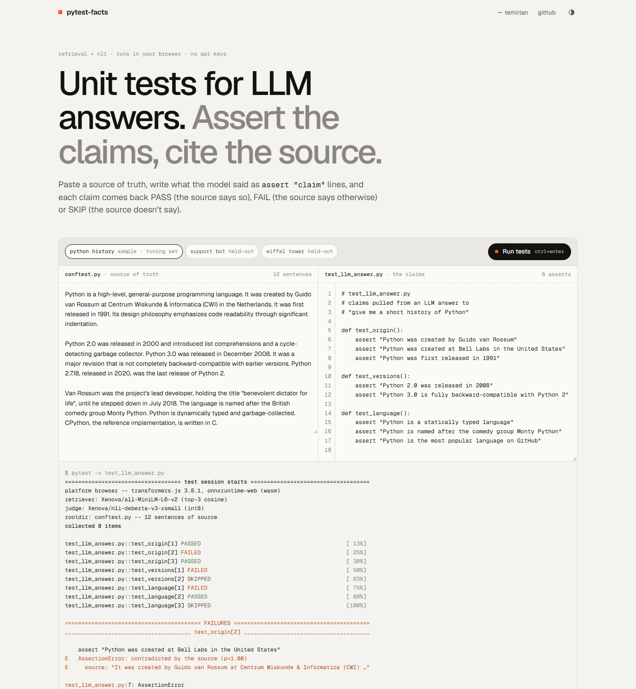

# pytest-facts — unit tests for LLM answers

Paste a source of truth, write what an LLM said as `assert "claim"` lines, and get pytest-style output: each claim is **PASS** (the source entails it), **FAIL** (the source contradicts it) or **SKIP** (the source is silent). Retrieval + NLI, entirely in the browser. No API keys, no server.

**Live demo: https://temirlanzzz.github.io/pytest-facts/**



## How it works

1. **Split** the source into sentences on `. ! ?` followed by whitespace and a capital letter (so "Python 3.0" and "$50.00" stay whole).
2. **Build premises.** A bare sentence like "It was first released in 1991" is meaningless to an NLI model, so each sentence is joined with the sentences its pronouns point back to (walk back to the last sentence that doesn't start with *it / they / this…*) plus the document's first sentence.
3. **Retrieve** the top-3 premises per claim by cosine similarity with [`Xenova/all-MiniLM-L6-v2`](https://huggingface.co/Xenova/all-MiniLM-L6-v2) (q8).
4. **Judge** each (premise, claim) pair with the cross-encoder [`Xenova/nli-deberta-v3-xsmall`](https://huggingface.co/Xenova/nli-deberta-v3-xsmall) (int8 ONNX). Label order is read from its `config.json` (`0 contradiction, 1 entailment, 2 neutral`).
5. **Verdict:** any evidence with entailment ≥ 0.5 → PASS; otherwise any contradiction ≥ 0.5 → FAIL; otherwise SKIP.

Both models run through [transformers.js](https://github.com/huggingface/transformers.js) **3.8.1** (pinned, from jsDelivr) on onnxruntime-web/WASM. Each claim in the UI expands to its three evidence sentences with cosine scores and entailment / contradiction / neutral probabilities.

## Results (measured by me)

Labelled eval set in [`js/data.js`](js/data.js): the 8-claim Python sample used for tuning, plus **14 held-out claims over 3 sources, written and committed before any tuning** (see git history). Run it yourself at [`eval.html`](https://temirlanzzz.github.io/pytest-facts/eval.html).

| set | correct |
|---|---|
| tuning sample (3 true, 4 false, 1 unsupported) | **7/8** |
| held-out (6 true, 5 false, 3 unsupported) | **12/14** |
| all 22, by label | PASS 9/9 · FAIL 8/9 · SKIP 2/4 |

Misses:

- `Python 3.0 is fully backward-compatible with Python 2` (tuning) → SKIP instead of FAIL. The right sentence ("not completely backward-compatible") is retrieved, the model says neutral.
- `Guido van Rossum worked at Google` (held-out) → FAIL instead of SKIP. "Created by Guido van Rossum at CWI" is read as a contradiction.
- `Northwind Audio offers a two-year warranty on all products` (held-out) → FAIL instead of SKIP.

Both held-out misses are the same failure: silent gets called false.

Design choices, scored on the tuning set only: bare sentences 4/8, previous-sentence premises 6/8, pronoun-chain + first sentence 7/8. Thresholds don't matter much: the model's probabilities are nearly always > 0.9 or < 0.1, and every passAt/failAt pair from 0.3 to 0.9 scored the same.

Timings (headless Chrome 155, Windows desktop, single-threaded WASM; accuracy was identical on every repeat):

| | |
|---|---|
| model load, cold cache (downloads ~115 MB) | 9.8–10.9 s (3 fresh profiles) |
| model load, from browser cache | 1.3–1.7 s |
| 8-claim run (24 NLI pairs), 5 repeats after warm-up × 5 page loads | median 2.3 s, range 1.9–4.1 s (25 runs) |
| first run in the UI (includes one-time graph warm-up) | 2.2–3.7 s |

## What I learned

- **Pronouns break sentence-level NLI and retrieval.** With bare sentences, "It was created by Guido van Rossum" didn't even make the top 3 for "Python was created by Guido van Rossum".
- **"Previous sentence" isn't enough** for chains like "It was created… It was first released in 1991". Walking back to the last sentence that names its subject fixed it.
- **Context has a price:** adding the first sentence everywhere lets "The tower is 330 metres tall" "prove" the tower is in Paris. The UI shows that context in grey rather than hiding it.
- **The model was fine; what I fed it mattered.** Changing premises moved the tuning score from 4/8 to 7/8; changing thresholds moved it by zero.

## Run locally

Any static file server works (ES modules need http, not `file://`):

```sh
git clone https://github.com/temirlanzzz/pytest-facts
cd pytest-facts
python -m http.server 8000
# open http://localhost:8000  and  http://localhost:8000/eval.html
```

Headless check (no dependencies, Node 22+): `node tools/cdp.mjs http://127.0.0.1:8000/eval.html "window.__EVAL"` prints the eval and any console errors.

## Structure

```
index.html      page, styles, write-up
eval.html       labelled eval + timings, runs in the browser
js/core.js      splitter, assert parser, premises, retrieval, NLI, verdict
js/app.js       editors, presets, pytest-style terminal, evidence cards
js/data.js      sources, tuning set, held-out set
tools/cdp.mjs   tiny Chrome DevTools driver used for eval and screenshots
```

## Limits

- Small NLI model with a bias towards "false": 2 of 4 unsupported claims came back FAIL. Treat FAIL as "go check".
- 22 labelled claims shows the failure modes; it is not a precise accuracy estimate.
- No real numeric reasoning (years mostly work; ranges, units and arithmetic don't).
- One claim per line, judged alone; compound claims should be split. The splitter breaks on abbreviations like "Dr. Smith".
- The "LLM answers" in the presets are hand-written, not sampled from a model.

## License

MIT
